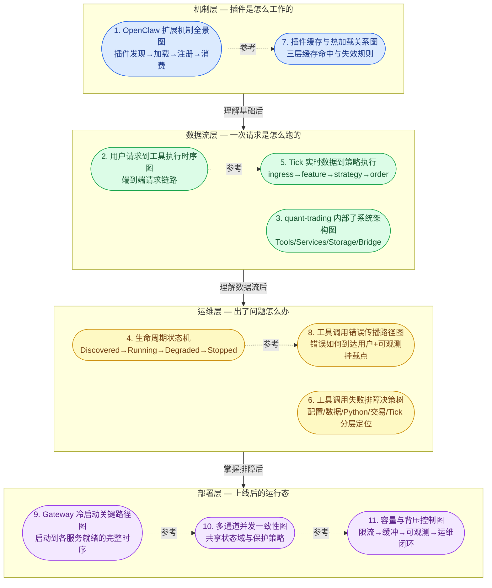
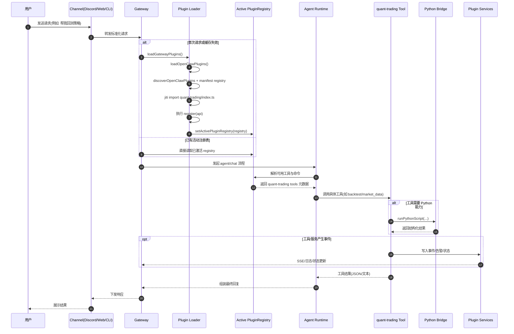
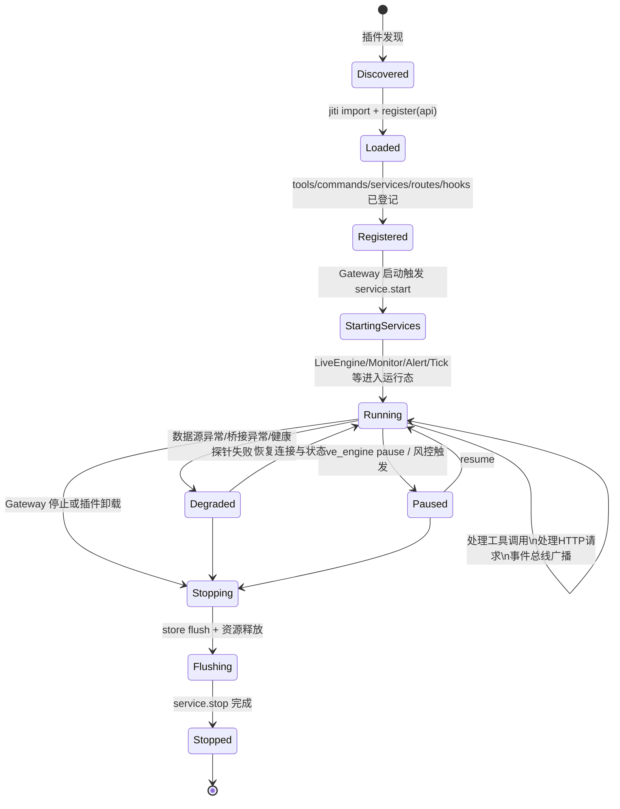
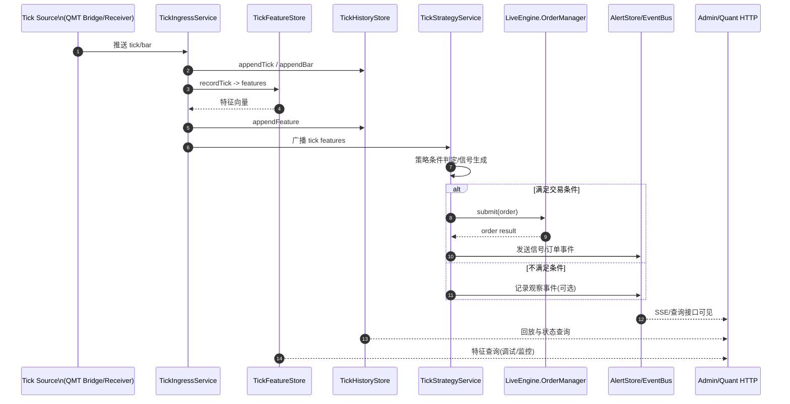
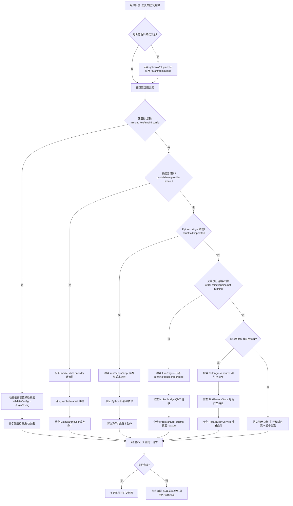
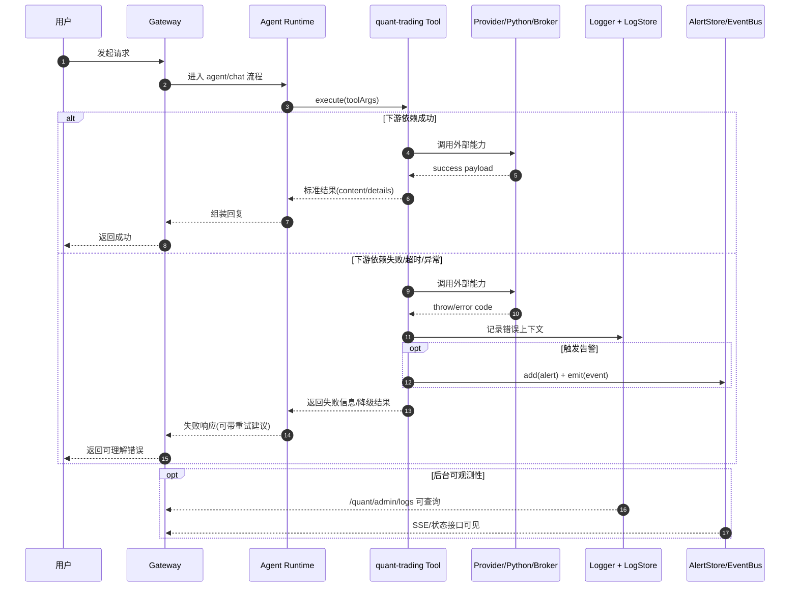
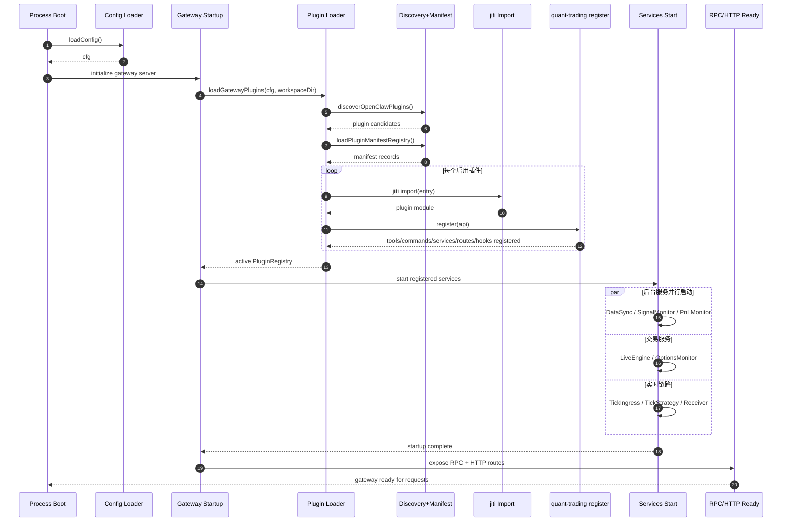
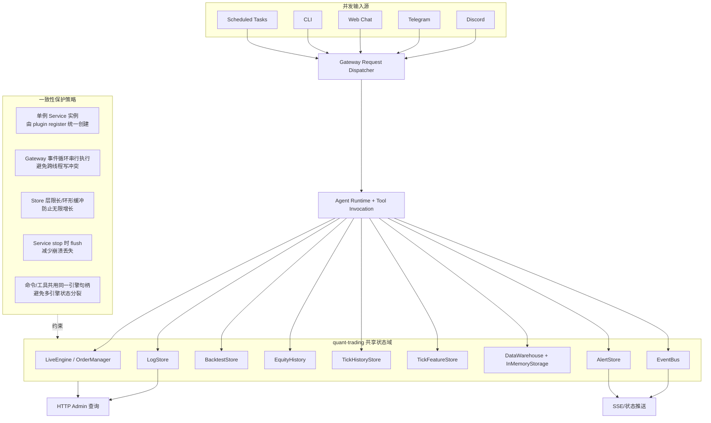
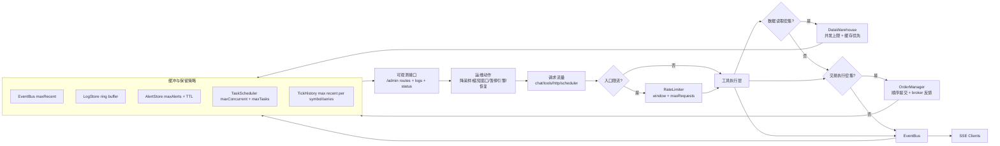

# quant-trading 架构图谱

本文件汇总了 quant-trading 扩展在 OpenClaw 插件体系中的完整架构视图，包含机制、时序、生命周期、排障和运维等多个维度，可配合 [ARCHITECTURE_ANALYSIS.md](./ARCHITECTURE_ANALYSIS.md) 一同阅读。

---

## 总览地图（阅读索引）

> 按 **机制 → 数据流 → 运维 → 部署** 四层分组，推荐按箭头方向阅读。



---

## 目录

1. [OpenClaw 扩展机制全景图](#1-openclaw-扩展机制全景图)
2. [用户请求到工具执行时序图](#2-用户请求到工具执行时序图)
3. [quant-trading 内部子系统架构图](#3-quant-trading-内部子系统架构图)
4. [生命周期状态机](#4-生命周期状态机)
5. [Tick 实时数据到策略执行的数据流](#5-tick-实时数据到策略执行的数据流)
6. [工具调用失败排障决策树](#6-工具调用失败排障决策树)
7. [插件缓存与热加载关系图](#7-插件缓存与热加载关系图)
8. [工具调用错误传播路径图](#8-工具调用错误传播路径图)
9. [Gateway 冷启动关键路径图](#9-gateway-冷启动关键路径图)
10. [多通道并发一致性图](#10-多通道并发一致性图)
11. [容量与背压控制图](#11-容量与背压控制图)

---

## 1. OpenClaw 扩展机制全景图

> 描述：插件从发现、加载、注册到运行时消费的完整链路。

```mermaid
flowchart TB
  U[用户消息\nDiscord/Telegram/Web/CLI] --> G[Gateway Server]
  G --> GP[loadGatewayPlugins]
  GP --> L[loadOpenClawPlugins]

  subgraph D[插件发现与解析]
    R[resolvePluginSourceRoots\nworkspace/global/bundled/config] --> DISC[discoverOpenClawPlugins]
    DISC --> MR[loadPluginManifestRegistry]
    MR --> CAND[候选插件 + manifest 元数据]
  end

  L --> D
  CAND --> JI[jiti 动态加载插件入口\nalias: openclaw/plugin-sdk]
  JI --> REG[createPluginRegistry + createApi]

  subgraph EXT[quant-trading 插件 register(api)]
    T[registerTool\nmarket_data/backtest/portfolio/...]
    CMD[registerCommand\n聊天快捷命令]
    CLI[registerCli\nquant 子命令]
    SVC[registerService\nLiveEngine/DataSync/Monitor/...]
    HTTP[registerHttpRoute\n由 registerQuantRoutes/registerAdminRoutes 挂载]
    HK[api.on before_prompt_build\n注入量化工作流系统提示]
  end

  REG --> EXT

  subgraph PR[PluginRegistry]
    P1[plugins]
    P2[tools]
    P3[channels]
    P4[gatewayHandlers]
    P5[httpRoutes]
    P6[services]
    P7[commands]
    P8[hooks]
  end

  EXT --> PR
  PR --> ACT[setActivePluginRegistry\n全局活动注册表]

  ACT --> RT1[Agent 工具执行路径\n从 registry.tools 调用]
  ACT --> RT2[Channel 查找路径\ngetChannelPlugin/listChannelPlugins]
  ACT --> RT3[Gateway 方法扩展\n合并 plugin gatewayMethods]
  ACT --> RT4[HTTP 路由分发\n插件路由进入网关]
  ACT --> RT5[生命周期服务\n网关启动/停止时管理]

  RT1 --> OUT[返回响应到网关]
  RT2 --> OUT
  RT3 --> OUT
  RT4 --> OUT
  RT5 --> OUT
  OUT --> U
```

---

## 2. 用户请求到工具执行时序图

> 描述：一条真实请求从 Channel 进入，经 Agent 调用 quant 工具，最后返回用户的完整时序。



---

## 3. quant-trading 内部子系统架构图

> 描述：register(api) 内部各层的依赖关系：Tools / Services / Storage / Bridge。

```mermaid
flowchart LR
  subgraph Core[OpenClaw 插件容器]
    API[OpenClawPluginApi]
    REG[Plugin Registry Entries]
  end

  subgraph QT[quant-trading register(api)]
    CFG[Config & Validation]
    TOOLREG[Tool Registration]
    CMDREG[Command & CLI Registration]
    SVCREG[Service Registration]
    ROUTEREG[HTTP Routes Registration]
    HOOKREG[Prompt Hook Registration]
  end

  API --> QT
  QT --> REG

  subgraph Tools[AI Tools 层]
    T1[market_data / stock_screen]
    T2[backtest / strategy_*]
    T3[portfolio / live_trading / conditional_order]
    T4[options_* / risk_analysis]
    T5[fund_flow / sector_* / sentiment]
    T6[data_cache / scheduled_task / price_alert]
  end

  subgraph Services[后台服务层]
    S1[LiveEngine]
    S2[DataSyncService]
    S3[SignalMonitor / PnLMonitor]
    S4[OptionsMonitor]
    S5[TickIngressService]
    S6[TickStrategyService]
    S7[PriceAlertService]
    S8[TaskScheduler]
    S9[ReceiverService]
  end

  subgraph Storage[状态与存储]
    ST1[AlertStore]
    ST2[BacktestStore]
    ST3[ScanHistoryStore]
    ST4[OptimizationStore]
    ST5[EquityHistory]
    ST6[TickHistoryStore]
    ST7[InMemoryStorage / DataWarehouse]
    ST8[TradeJournal / Strategy Stores]
    EB[EventBus]
    LOG[LogStore]
  end

  subgraph Bridge[外部能力桥接]
    PY[Python Bridge\nbacktrader/akshare/tushare]
    BRK[Broker Bridge\nQMT/Paper]
    FEED[Market Data Providers]
  end

  Tools --> Services
  Tools --> Storage
  Tools --> Bridge
  Services --> Storage
  Services --> Bridge
  Storage --> ROUTEOUT[Admin & Quant HTTP APIs]
  EB --> ROUTEOUT
  LOG --> ROUTEOUT

  ROUTEREG --> ROUTEOUT
  TOOLREG --> Tools
  CMDREG --> CmdOut[Chat Commands + quant CLI]
  SVCREG --> Services
  HOOKREG --> PromptOut[before_prompt_build System Context]
```

---

## 4. 生命周期状态机

> 描述：从插件发现到 gateway 停止的完整生命周期状态转移，含 Running/Paused/Degraded 路径。



---

## 5. Tick 实时数据到策略执行的数据流

> 描述：Tick 从数据源进入，经过 ingress → feature → strategy → order 的完整链路。



---

## 6. 工具调用失败排障决策树

> 描述：从"工具失败/无结果"出发，分层定位配置/数据/Python/交易/Tick 五类根因。



---

## 7. 插件缓存与热加载关系图

> 描述：三层缓存（Discovery / Manifest / Registry）的命中条件、失效规则与关键安全约束。

```mermaid
flowchart LR
  subgraph Inputs[输入维度]
    I1[workspaceDir]
    I2[plugins.loadPaths]
    I3[plugins.allow/deny/entries]
    I4[plugins.installs]
    I5[onlyPluginIds/setup-only mode]
    I6[env knobs\nOPENCLAW_PLUGIN_*_CACHE_MS]
  end

  Inputs --> DK[Discovery Cache Key]
  Inputs --> MK[Manifest Cache Key]
  Inputs --> RK[Registry Cache Key]

  DK --> DC[Discovery Cache\n~1s 默认窗口]
  MK --> MC[Manifest Registry Cache\n~1s 默认窗口]
  RK --> RC[Plugin Registry Cache\nLRU, max 128]

  subgraph LoadFlow[加载流程]
    L1[discoverOpenClawPlugins]
    L2[loadPluginManifestRegistry]
    L3[loadOpenClawPlugins]
    L4[createPluginRegistry/createApi]
    L5[jiti import + register(api)]
    L6[setActivePluginRegistry]
  end

  DC --> L1
  MC --> L2
  RC --> L3

  L1 --> L2 --> L3 --> L4 --> L5 --> L6

  L3 --> C1{cache 命中?}
  C1 -- 是 --> C2[直接返回 registry\n并可激活为 active]
  C1 -- 否 --> C3[执行完整发现/导入/注册]

  C3 --> C4[写入 registry cache]
  C4 --> L6

  subgraph Notes[关键规则]
    N1[activate:false 必须 cache:false\n避免命令注册状态不一致]
    N2[clearPluginCommands 仅在 shouldActivate 时执行]
    N3[allowlist 为空且有非 bundled 插件\n会发安全告警]
  end

  L3 --> Notes
```

---

## 8. 工具调用错误传播路径图

> 描述：工具失败时错误如何从 Provider/Python/Broker 层传播到用户，以及可观测性挂载点。



---

## 9. Gateway 冷启动关键路径图

> 描述：从进程启动到 quant-trading 所有服务就绪、RPC/HTTP 对外可用的完整时序。



---

## 10. 多通道并发一致性图

> 描述：多个 Channel 并发请求如何共享 quant-trading 状态域，以及一致性保护策略。



---

## 11. 容量与背压控制图

> 描述：从入口限流到各存储缓冲、可观测接口，再到运维动作的完整闭环。



---

_本文件由 GitHub Copilot 辅助生成，基于 2026-03-26 版本代码分析。_
